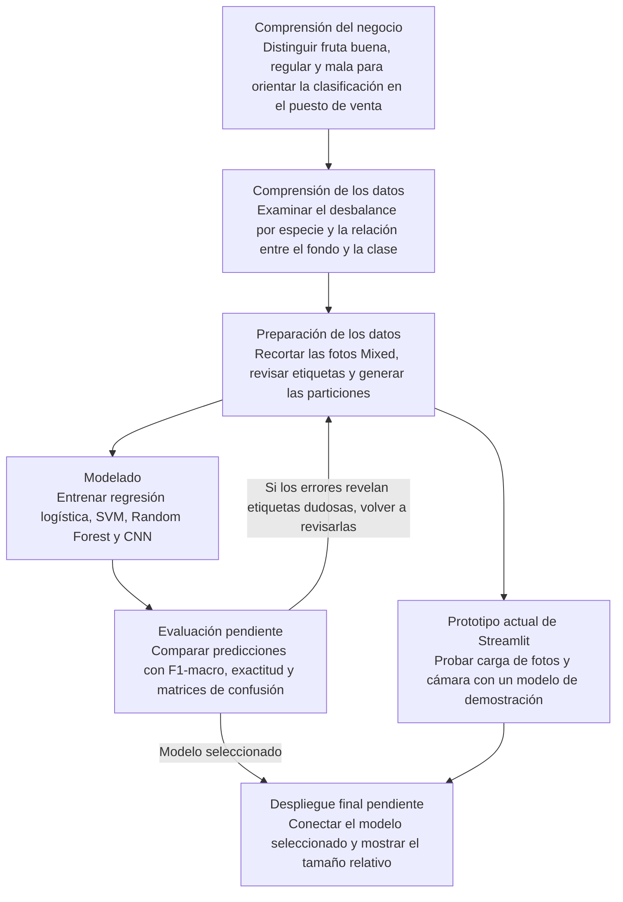

# CRISP-DM aplicado a la clasificación de frutas

**Evidencia en el repositorio.** El planteamiento del negocio y el EDA explican la clase *regular* y los posibles efectos del fondo. La preparación aplica una guía común a las fotos propias y al conjunto público. [Planteamiento](01_introduccion_negocio_datos.md) · [EDA](../../notebooks/01_eda.ipynb) · [Guía de etiquetado](../guia_etiquetado.md) · [Preprocesamiento](../../src/data/preprocess.py)

Los programas de entrenamiento y comparación definen cómo se obtendrán las predicciones y métricas. El prototipo permite probar la interacción mientras se selecciona el modelo. [Modelos clásicos](../../src/models/train_classical.py) · [Entrenamiento de la CNN](../../src/training/train_cnn.py) · [Evaluación](../../src/evaluation/compare_models.py) · [Interfaz](../../app/app.py)

**Revisión de las particiones.** En `Lime_Bad`, `IMG_7279.JPG` quedó en entrenamiento y `IMG_7280.JPG` en prueba. Las dos fotos muestran el mismo limón con las mismas manchas y un leve cambio de ángulo. Repartir una ráfaga entre particiones puede elevar el desempeño aparente sobre frutas nuevas. Antes de interpretar las métricas, conviene identificar estas secuencias, asignar cada ejemplar a una sola partición y repetir la evaluación. [Manifiesto de particiones](../../data/splits.csv)
